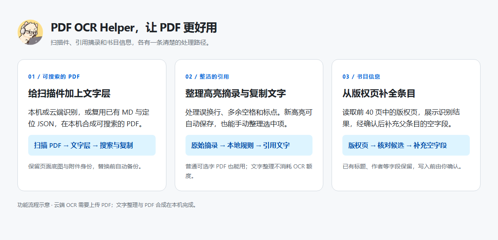
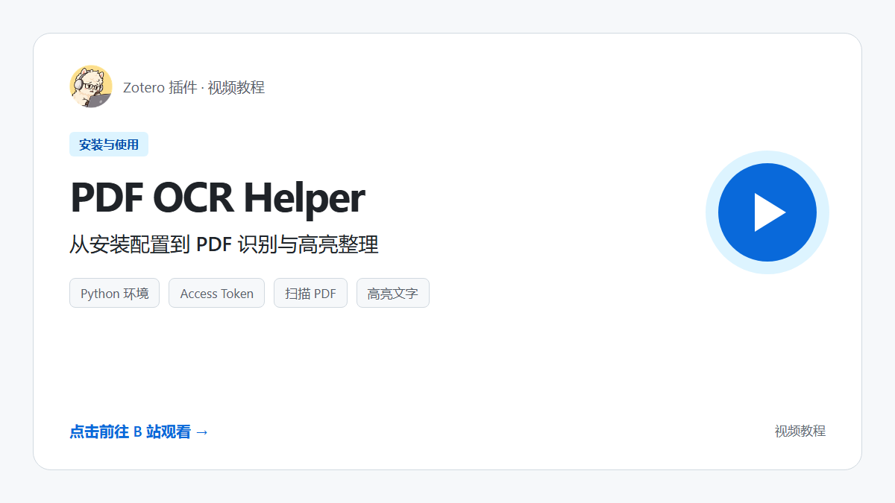
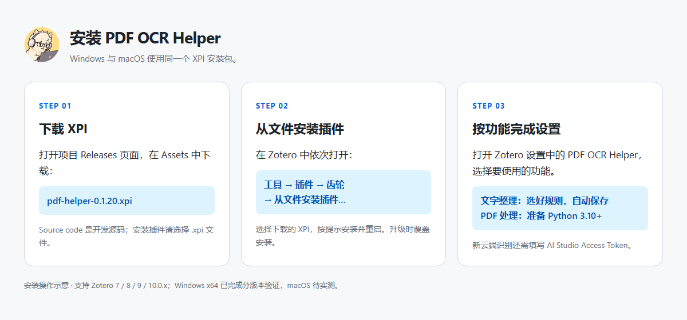
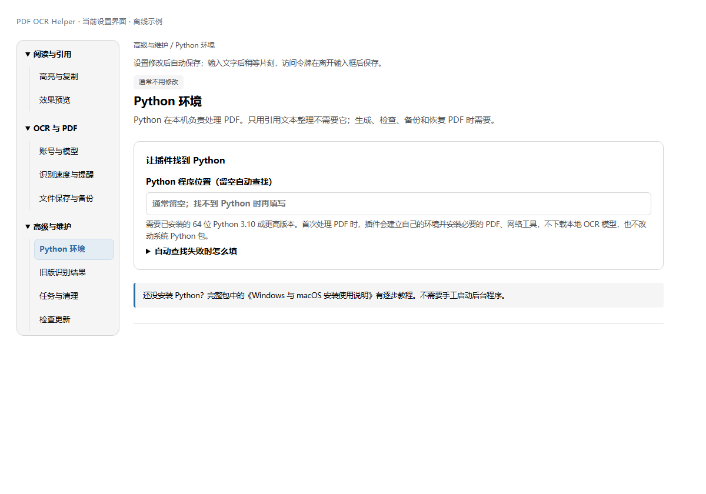
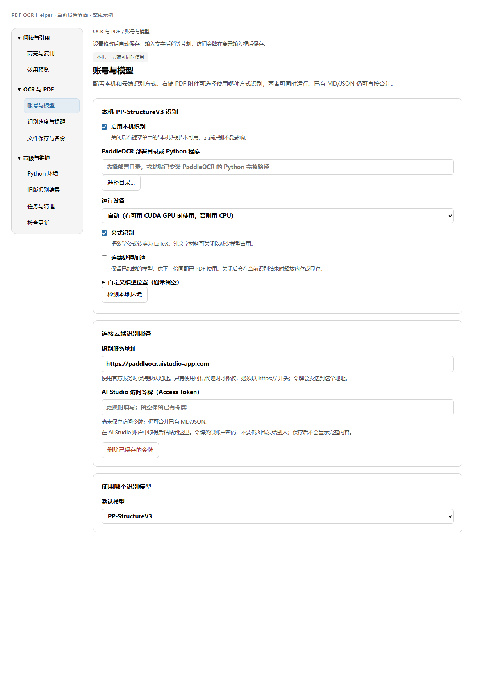
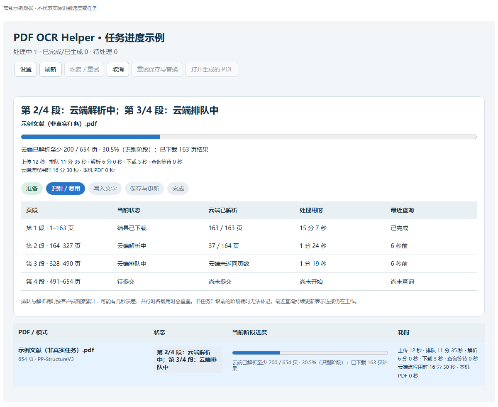
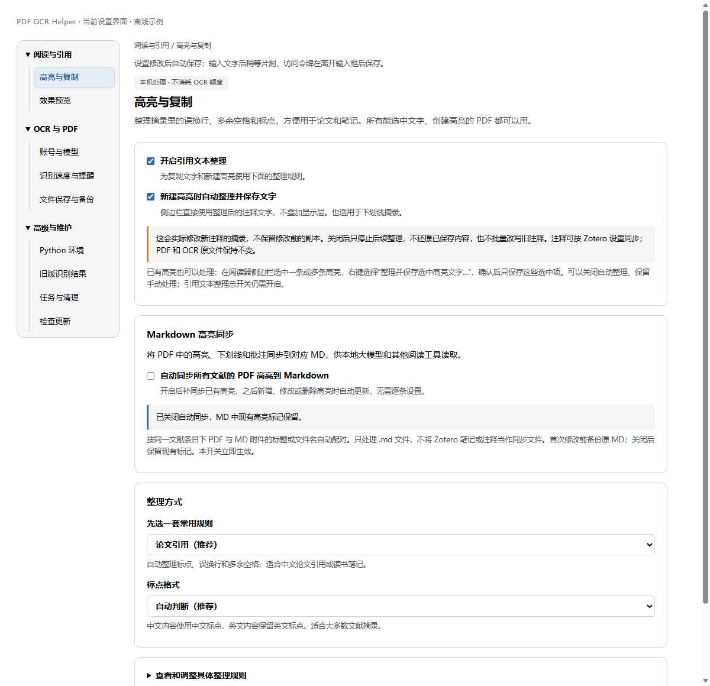
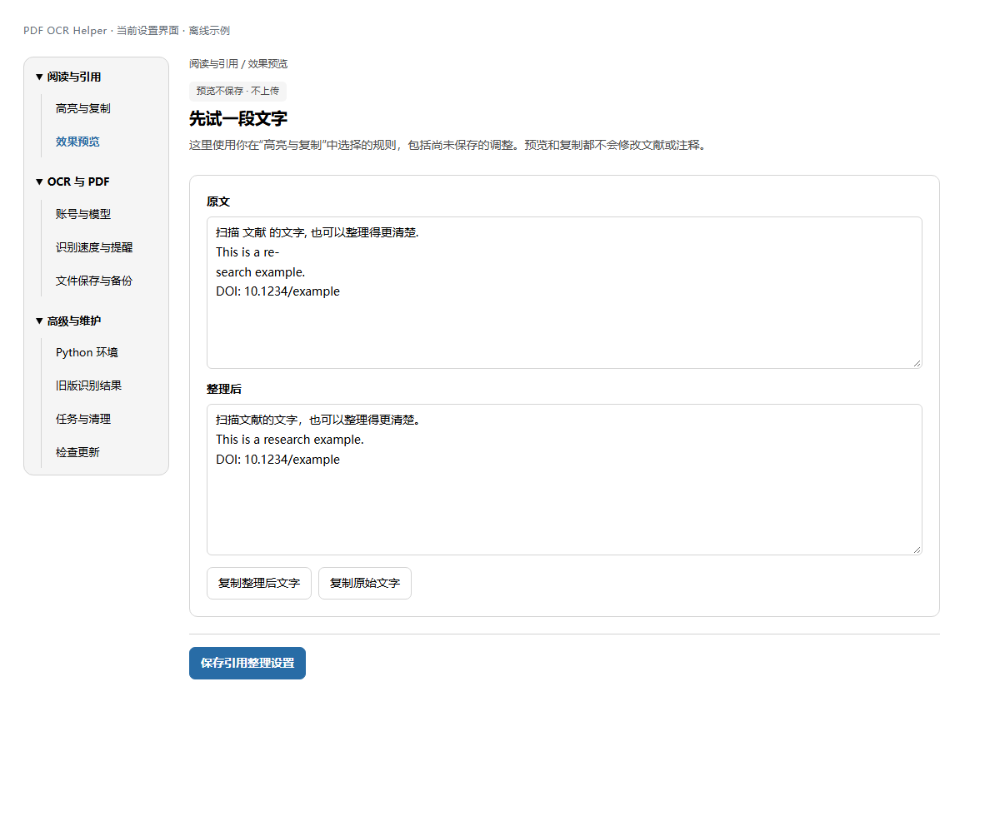

# PDF OCR Helper：将图片型PDF转换为可编辑引用的文本

[](https://www.zotero.org/)
[](https://github.com/windingwind/zotero-plugin-template)
[](LICENSE)
[](https://github.com/Philippyang21/zotero-pdf-helper/releases)
[](https://github.com/Philippyang21/zotero-pdf-helper/stargazers)
[](https://github.com/Philippyang21/zotero-pdf-helper/releases)

<p align="center">
  
</p>

PDF OCR Helper依托paddleocr，为 Zotero 中的图片型 PDF 添加可搜索、可复制的文字层。能够整理高亮摘录的注释文字，包括中英文标点转换、删除多余空格等，并从书籍版权页补充文献条目信息。


> **下载与更新**：正式安装包见 [Releases](https://github.com/Philippyang21/zotero-pdf-helper/releases)。本地测试包可从文件覆盖安装。

> **0.1.20 更新**：新增本地部署接入，优化设置菜单，删除保存按钮，修改后自动保存。[本地接入教程](#接入本地部署的-pp-structurev3) · [更新说明](docs/CHANGELOG-0.1.20.md)。

> **Markdown 全局同步**：在“高亮与复制”中开启一个开关，即可按标题自动匹配所有文献条目下的 PDF 和 MD，无需逐条设置。[使用说明](docs/CHANGELOG-0.1.18.md)。

## 目录

- [视频教程](#视频教程)
- [功能自述](#功能自述)
- [安装](#安装)
- [使用](#使用)
  - [接入本地部署的 PP-StructureV3](#接入本地部署的-pp-structurev3)
- [数据与隐私](#数据与隐私)
- [致谢与许可证](#致谢与许可证)

## 视频教程

[](https://www.bilibili.com/video/BV1Gunh6cErB/)

**[前往 B 站观看视频教程](https://www.bilibili.com/video/BV1Gunh6cErB/)**

视频将在插件正式发布后公开。

## 功能自述

这个小玩意儿其实干不了什么事儿，主要是解决我，或者和我一样的中文系学生在Zotero上看文献的一个痛点。

众所周知，我们下载的许多中文扫描书籍是图片型PDF，无法直接在上面标注与复制提取文字；而从知网上下载的大多数论文，虽然能够提取文字，也存在大量恼人的英文标点和空格。

前者虽然WPS等软件的ocr功能能够解决，但是如果遇到本身扫描质量不高的，识别率很低。后者有拷贝鸭之类的工具能够解决，但是复制-切换软件-粘贴-转换-复制-切换软件-粘贴，这么一趟久了也略显繁琐。

使用PaddleOCR的模型在线转换能够大大提高准确率，并且一天20000页的额度对于我们来说也绝对够用，但是它输出的文件是markdown和json格式的，尽管在Zotero中也能显示，出于一点点文献学的考虑，我们还是希望它能够尽可能保持书籍原汁原味的排版装帧。

这个小插件解决的就是这个问题，原理其实很简单，通过接入PaddleOCR的在线转换，输出md和json文件，再依据这两个文件，在原图PDF上面覆盖一层不可见的文字层，当然，也可以完全回退成原文件。

于是，我们就可以直接在原PDF上进行阅读、高亮或划线文本，并且也可以自动在侧边栏显示你选定提取的书籍文字。考虑到ocr在识别文本分行时会转换为空格，标点符号有时也会被误判为英文标点，特地加入了自动转换和删除空格的功能，相关规则可以按需自定义。这样你选定文本时，输出的就是自动转换完的文本，更利于整理引文。

## 安装



### 1. 下载并安装插件

在 [Releases 页面](https://github.com/Philippyang21/zotero-pdf-helper/releases) 的 **Assets** 中下载对应版本的 `pdf-helper-版本号.xpi`。

在 Zotero 中打开 **工具 → 插件 → 齿轮 → 从文件安装插件…**，选择 XPI，按提示安装并重启。Windows 与 macOS 使用同一个安装包。旧版用户直接覆盖安装，插件 ID、已有设置、令牌和任务路径继续沿用。

本版本支持 **Zotero 7、8、9 与 10.0.x**。插件核心流程此前已在 Windows x64 的 **7.0.32、8.0.4、9.0.6、10.0.6** 上完成分版本原生验证；本版验证范围见 [测试记录](docs/TESTING.md)，历史兼容验证见 [兼容性说明](docs/COMPATIBILITY.md)。

### 2. 按需要准备环境

- **只用高亮和复制文字整理**：安装插件后即可配置，不需要 Python、API 令牌或本地模型。
- **使用 OCR 核心功能**：需要先完成本地 Python 配置，方法见 [Python 安装与配置说明](docs/USAGE.md#为什么还要安装-python)。
- **本机 PP-StructureV3**：选择已安装模型的环境，可用 CPU 或 CUDA GPU，并可设置公式识别与连续处理加速。参见[本地部署接入教程](#接入本地部署的-pp-structurev3)。
- **云端访问令牌**：登录 [PaddleOCR 官网](https://aistudio.baidu.com/paddleocr)，在 **API** 选项中获取 **AI Studio Access Token**，并在插件的 **账号与模型** 中填写，离开输入框后自动保存。

在 **设置 → PDF OCR Helper → 高级与维护 → Python 环境** 中，Python 路径通常先留空；自动查找失败时再填写完整程序路径。



*当前设置界面的离线示例。Windows 与 macOS 的 Python 安装步骤见 [详细安装说明](docs/USAGE.md)。普通用户不需要安装 Node.js 或运行构建命令。*

## 使用

以下设置与任务截图由当前插件界面离线渲染，使用示例文字和任务数据。

### 把扫描 PDF 变为可搜索 PDF

**需要新识别时：**

1. 打开 **设置 → PDF OCR Helper → OCR 与 PDF → 账号与模型**，启用本机识别并指定部署目录，或填写云端 Access Token。设置自动保存；令牌在离开输入框后保存。
2. 右键 Zotero 中的 PDF，选择 **本机 PP-StructureV3 识别并替换为可检索 PDF** 或 **云端识别并替换为可检索 PDF**。
3. 在任务窗口查看识别页数和 PDF 生成进度。



**已经有 MD 与定位 JSON 时：**

把 PDF 和匹配的 `.md`、`.json` 放在同一文献条目下，右键 PDF，选择 **合并已有 MD/JSON，生成可检索 PDF**。也可通过文件选择器选用库外文件。这条路径不需要令牌，不重复 OCR。

JSON 需要包含文字、坐标和页面尺寸，或有可核实的 PDF 渲染倍率。只有 Markdown 无法准确定位文字；格式与旧版 JSON 处理见 [JSON 说明](docs/JSON.md)。



等待时间较长时，先看原任务状态。暂停任务用 **恢复 / 重试** 继续，避免反复新建任务。任务窗口也可打开结果目录、整理 MD/JSON，或查看恢复提示。

### 接入本地部署的 PP-StructureV3

本地识别使用你电脑上的 **PP-StructureV3** 环境，不需要 AI Studio Access Token。插件会直接启动这个环境中的 Python；XPI 不附带模型，也不会替你安装 PaddleOCR。云端配置可以继续保留，识别时从右键菜单选择本机或云端。

#### 1. 准备可运行的 PaddleOCR 环境

已经部署过 PP-StructureV3，可以直接使用原环境。首次部署请按 [PaddleOCR 安装教程](https://www.paddleocr.ai/latest/version3.x/installation.html) 和 [PP-StructureV3 官方教程](https://www.paddleocr.ai/latest/version3.x/pipeline_usage/PP-StructureV3.html) 安装适合当前系统的 PaddlePaddle、PaddleOCR 3.x 及文档解析依赖（`doc-parser`，包括 `pypdfium2`）。CPU 与 CUDA GPU 的 PaddlePaddle 安装包不同，按官方说明选择即可。

在已经激活的部署环境中运行：

```bash
python -c "import sys, paddle, pypdfium2; from paddleocr import PPStructureV3; print(sys.executable); print('PaddlePaddle:', paddle.__version__)"
```

记下输出的 **Python 完整路径**。接入前，先按官方教程在这个环境中成功识别一张本机图片，确认依赖和模型能够使用。

#### 2. 在插件里填写本地环境

打开 **Zotero 设置 → PDF OCR Helper → OCR 与 PDF → 账号与模型**：

1. 勾选 **启用本机识别**。
2. 在 **PaddleOCR 部署目录或 Python 程序** 中填写上一步的 Python 完整路径，也可点击 **选择目录…** 选择部署目录或虚拟环境目录。
3. 选择运行设备及所需选项。修改后会自动保存，文字输入停止约半秒或离开输入框时保存，无需点击保存按钮。
4. 点击 **检测本地环境**，确认出现 PaddleOCR 版本和设备信息。此检测检查环境导入及设备；完整模型权重在首次识别时加载。

| 设置 | 怎么填写或选择 |
| --- | --- |
| Python / 部署目录 | Windows 示例：`D:\OCR\.venv\Scripts\python.exe`；macOS 示例：`/Users/你的用户名/OCR/.venv/bin/python`。也可选择含 `.venv` 的项目目录、虚拟环境根目录或 Conda 环境目录。 |
| 运行设备 | **自动**：有可用 CUDA GPU 时使用，否则使用 CPU；**CPU**：固定使用处理器；**第一块 CUDA GPU**：需要可运行的 NVIDIA CUDA 环境。 |
| 公式识别 | 含数学公式时开启；纯文字书籍可关闭，减少模型加载和内存占用。 |
| 连续处理加速 | 开启后，同一配置的后续 PDF 可以复用已加载的模型；关闭后，空闲模型释放，正在运行的模型在当前任务结束后释放。 |
| PaddleX 缓存目录 | 通常留空。模型放在其他位置时，填写**包含 `official_models` 文件夹的缓存根目录**，例如 `D:\OCR\models`。 |
| PP-StructureV3 配置文件 | 通常留空。自定义模型可填本机 PaddleX YAML 完整路径，配置中的模型路径使用绝对路径。 |

若部署目录中已有 `models/official_models`，插件会自动使用对应缓存；也可以沿用 PaddleX 默认缓存或已有的 `PADDLE_PDX_CACHE_HOME`。离线使用前，应在同一环境和缓存下备齐所选功能需要的权重；缺少权重时 PaddleOCR 仍可能尝试联网下载。

这里填写的是本机可执行的 Python 或目录，不填网页地址、`.bat` 启动脚本或单独的模型权重文件。仅在 Docker、WSL 或远端 HTTP 服务中运行的模型，不能直接填入本版入口；需要 Zotero 所在系统可以直接启动的 Python 环境。该入口接入 PP-StructureV3，云端模型列表中的 PaddleOCR-VL 不作为本地模型选择。

**两个 Python 设置有什么区别？** “账号与模型”里的路径属于你部署的 OCR 模型环境；“高级与维护 → Python 环境”用于插件生成 PDF 文字层、备份和恢复。两者可以使用不同的解释器，不必把 PaddleOCR 安装进插件创建的 PDF 工具环境。macOS 的模型接入仍需在目标机器验证，当前本地识别验证以 Windows 为主。

#### 3. 在 Zotero 中执行本地识别

1. 在文献条目下选中已经下载到本机的扫描 PDF。
2. 右键选择 **本机 PP-StructureV3 识别并替换为可检索 PDF**。
3. 在任务窗口查看模型加载、按页识别及 PDF 生成进度。首次识别需要加载模型，等待时间通常比后续任务长。
4. 检查完成后，插件按“文件保存与备份”设置处理 PDF、MD 和 JSON。自动替换前会备份原 PDF；需要撤销时使用 **恢复原始 PDF**。

想先检查生成结果，可在“文件保存与备份”中关闭 **检查通过后自动替换原 PDF**。取消后继续处理时，在原任务中使用 **恢复 / 重试**，可复用已经完成的页面。模型环境或设备设置的修改用于新建任务，恢复任务沿用创建时的配置。本地模型报错不会自动改用云端。

#### 接入时的常见问题

- **找不到 Python / 无法导入 PaddleOCR**：在部署环境重新运行上面的检测命令，将输出的完整程序路径填入插件，并确认 `paddle`、`paddleocr`、`pypdfium2` 都在同一环境中。
- **CUDA GPU 不可用**：先选 **自动** 或 **CPU**；需要 GPU 时，按官方说明检查驱动和 PaddlePaddle GPU 版。
- **首次加载卡住或内存不足**：查看任务错误信息；纯文字材料可关闭公式识别，减少同时加载的模型。CPU 识别较慢，可先用少量页面试运行。
- **离线时提示下载模型**：检查缓存根目录，并在相同环境和选项下提前完成一次模型加载；仅复制某一个权重文件通常不足以运行整条产线。

### 整理高亮与复制文字

打开 **设置 → PDF OCR Helper → 阅读与引用 → 高亮与复制**，开启引用文本整理，选择“论文引用（推荐）”，修改后自动保存。



在 **效果预览** 中粘贴一小段文字，核对规则是否适合当前材料。



- **新高亮**：开启“新建高亮时自动整理并保存文字”后，整理结果实际保存到注释摘录。
- **已有高亮**：在阅读器侧边栏选中高亮或下划线，右键选择 **整理并保存选中高亮文字…**，确认后处理选中项。
- **只复制文字**：使用选择弹框或高亮右键中的 **复制为论文引用文本**，也可保留原始文字。

自动与手动保存都会修改注释摘录，不保留修改前副本；关闭开关不会还原已保存内容。PDF、MD/JSON 和注释评论不变，其他高亮也不会被批量改写。诗歌、旧式排版和严格引文建议逐段核对。

### 从版权页补充书目信息

选中一个 PDF 附件，右键选择 **识别版权页并补全文献条目**。插件从前 40 页中的文字层或已有 OCR JSON 提取候选信息，展示标题、作者、卷次、版次、出版年、出版社等字段。

核对并确认后，只填写父条目中原本为空的字段；已有内容保留。没有文字层或可用识别结果时会提示，不自动发起云端识别。

### 保存识别资料与恢复原件

MD/JSON 可以放入独立存档、插件本机目录，或作为原文献下的存储/链接附件。跨设备下载遵循 Zotero 的附件同步设置；本机任务历史和恢复备份不会随文库自动同步。

需要撤销 PDF 替换时，右键选择 **恢复原始 PDF**。

## 数据与隐私

| 操作 | 数据在哪里处理 |
| --- | --- |
| 高亮与复制文字整理 | 在本机用规则处理，不调用 LLM 或 OCR API |
| 合并 MD/JSON、生成文字层、备份与恢复 | 由本机 Python 处理 |
| 本机 PP-StructureV3 | PDF 在指定 Python 环境中识别；缺少模型时 PaddleOCR 可能联网获取权重 |
| 新云端 OCR | PDF 上传至所配置的 PaddleOCR 服务 |
| 版权页提取 | 读取本机文字层或已有 OCR JSON，写入前确认 |

Access Token 使用 Zotero 的密码管理功能保存，不写入普通设置或任务日志；下载识别结果时不向对象存储转发 API Authorization。本机辅助服务仅监听回环地址，并使用随机凭证。

插件内的页数阈值是本机提醒，不代表账户剩余额度。服务费用、配额与数据处理规则以所用服务的说明为准，详见 [API 说明](docs/API.md)。

## 致谢与许可证


- [Zotero](https://www.zotero.org/)：提供文献管理平台与插件接口。
- [Zotero Plugin Template](https://github.com/windingwind/zotero-plugin-template)、[Plugin Toolkit](https://github.com/windingwind/zotero-plugin-toolkit) 与 [Plugin Scaffold](https://github.com/zotero-plugin-dev/zotero-plugin-scaffold)：提供模板结构、工具与构建流程。
- [PaddleOCR](https://github.com/PaddlePaddle/PaddleOCR)、[PyMuPDF](https://github.com/pymupdf/PyMuPDF) 与 [HTTPX](https://github.com/encode/httpx)：提供识别与本机处理所需能力。

项目沿用 **AGPL-3.0**，见 [LICENSE](LICENSE)。第三方组件保留各自许可证与署名，见 [依赖说明](docs/THIRD_PARTY.md)。本插件是社区项目。
